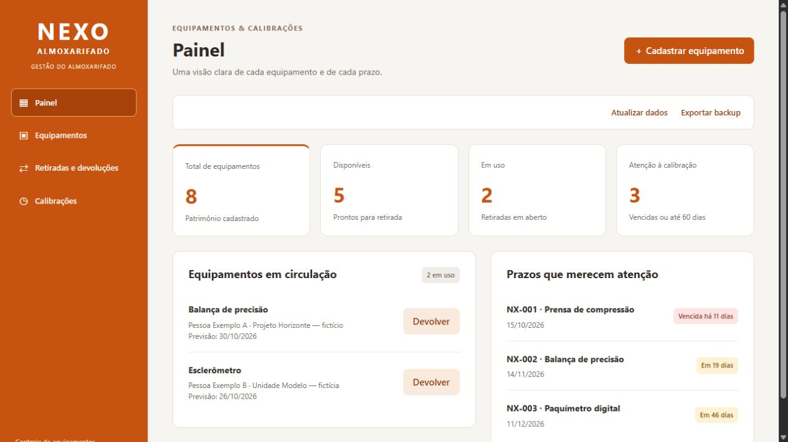
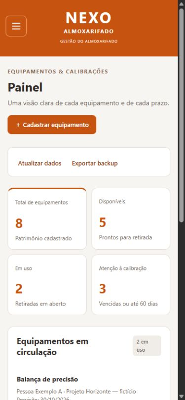
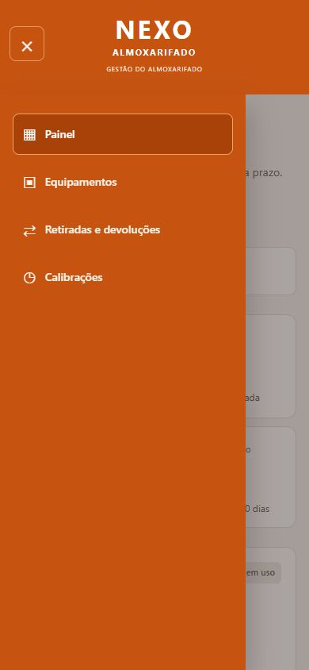
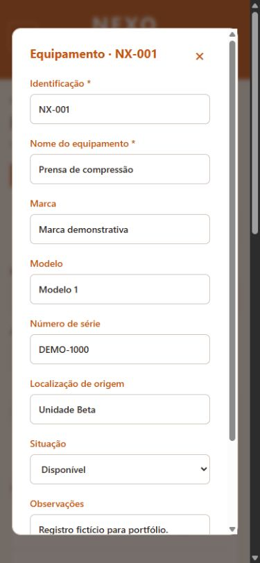

# Nexo Almoxarifado
Gestão de equipamentos, movimentações e calibrações em uma interface responsiva, construída com React e JavaScript.

**[Acessar demonstração](https://eduardooliveira3101.github.io/nexo-almoxarifado/)**

Projeto de portfólio com identidade e registros fictícios. A demonstração roda no navegador e não acessa sistemas ou bases corporativas.

## Telas do projeto

### Desktop

### Mobile

  
  
  

## Do controle à consulta
- Painel com disponibilidade dos equipamentos, retiradas em aberto e prazos de calibração.
- Cadastro e busca de equipamentos, com identificação, localização e condição.
- Retiradas com responsável, destino e previsão de devolução.
- Devoluções e histórico de movimentações.
- Registro de calibração, vencimentos e anexos PDF.
- Desativação com proteção do histórico e exportação dos registros.

## Escopo da demonstração
Os dados são guardados no localStorage do navegador. Não há autenticação real, servidor ou sincronização entre dispositivos. 

